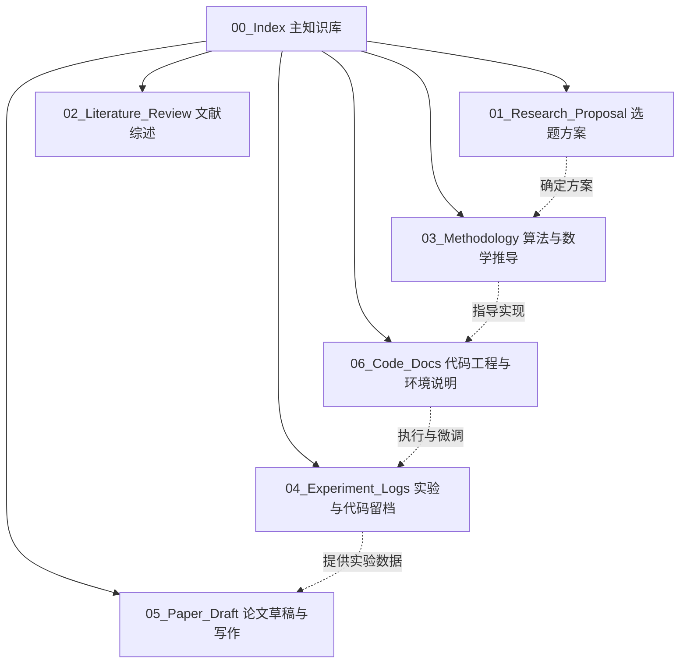

# 📚 医学影像处理与机器学习 EI 论文知识库

欢迎来到本项目知识库。本知识库用于系统化沉淀课程论文的研究方案、文献调研、算法数学推导、代码实现、以及**每次代码修改与对比实验的留档记录**。

---

## 🗺️ 知识库导航地图 (Map of Content)

### 1. 选题与开题 ([[01_Research_Proposal/Proposal_Overview|01_Research_Proposal]])
- [[01_Research_Proposal/Proposal_Overview|研究选题概览与可行性论证]]
- 核心拟定论文题：*FEE-Net: Frequency-guided Edge-aware Network for Accurate Medical Image Segmentation*

### 2. 文献调研与顶刊精读 ([[02_Literature_Review/Literature_Summary|02_Literature_Review]])
- [[02_Literature_Review/Literature_Summary|医学图像分割经典与前沿论文总结 (含 4 篇权威顶刊精读)]]
  - 🌟 **Nature Communications (IF: 14.7)**: [[02_Literature_Review/Paper_01_MedSAM_NatComm2024|MedSAM 通用大模型医学图像分割精读]]
  - 🌟 **IEEE TMI (IF: 8.9)**: [[02_Literature_Review/Paper_02_UNetPlusPlus_IEEE_TMI2020|UNet++ 密集嵌套跳跃连接网络精读]]
  - 🌟 **MedIA / MIDL (IF: 10.9)**: [[02_Literature_Review/Paper_03_Attention_UNet_MIDL2018|Attention U-Net 空间门控注意力机制精读]]
  - 🌟 **Medical AI 划时代 (Cited 4000+)**: [[02_Literature_Review/Paper_04_TransUNet_2021|TransUNet 混合架构医学分割精读]]
  - 🔥 **前沿焦点 (Mamba 状态空间模型)**: [[02_Literature_Review/Paper_05_VM_UNet_Mamba|VM-UNet 线性复杂度医学图像分割精读]]
- 🛠️ **专业文献翻译工具**：已在 `tools/` 安装部署 `pdf2zh`，双击 [`启动_文献双语翻译工具WebUI.bat`](file:///d:/machine_learning/tools/%E5%90%AF%E5%8A%A8_%E6%96%87%E7%8C%AE%E5%8F%8C%E8%AF%AD%E7%BF%BB%E8%AF%91%E5%B7%A5%E5%85%B7WebUI.bat) 可在浏览器拖拽任意 PDF 免费生成中英双语对照版。

### 3. 算法设计与数学推导 ([[03_Methodology/Network_Architecture|03_Methodology]])
- [[03_Methodology/Mathematical_Formulation|算法数学推导（离散小波高频分解、边缘注意力机制、边界损失函数）]]
- [[03_Methodology/Network_Architecture|网络架构设计规范与数据流图]]
- [[03_Methodology/System1_System2_Framework|System 1 (Laya 决策) + System 2 (FEE-Net 分割) 双阶段协同框架]]

### 4. 实验与代码留档 ([[04_Experiment_Logs/Exp_Index|04_Experiment_Logs]]) ⚠️ **核心规范**
- [[04_Experiment_Logs/Template_Experiment_Log|标准实验与代码修改留档模板]]
- [[04_Experiment_Logs/Exp_Index|📊 实验总览与版本生命周期管理矩阵]]（含数据可用性红绿灯规范）
- [[04_Experiment_Logs/Exp_Archive_Legacy_Prototypes|📦 历史实验与已废弃原型归档汇总]]（早期玩具数据与过度包装概念归档）
- **核心现行基准链**：
  - 架构与损失：FEE-Net v2.1 架构 [[04_Experiment_Logs/Exp_016_FEE_Net_v2_1_Bilinear_Depthwise_and_DeepSupervision|Exp-016]]、双分支极值分流与全景频域注意力升级 [[04_Experiment_Logs/Exp_028_DualBranch_Triage_and_Spectral_Wavelet_Overhaul|Exp-028]]、Boundary IoU 几何平滑损失 [[04_Experiment_Logs/Exp_012_Boundary_IoU_Loss_Overhaul|Exp-012]]
  - 统计风控与早退：根源去伪存真与有限样本保形风控 (CRC) [[04_Experiment_Logs/Exp_024_Root_Purification_and_Conformal_Risk_Control|Exp-024]]、FEENetEarlyExit 共享骨干与梯度解耦 [[04_Experiment_Logs/Exp_025_FEENet_EarlyExit_Pipeline_Integration_and_Gradient_Decoupling|Exp-025]]、四大范式全景验证 [[04_Experiment_Logs/Exp_026_Comprehensive_Practical_Verification_and_CRC_Calibration|Exp-026]]
  - 最新数据与卫生规范：全工程代码卫生与 v2 splits 150 例独立测试协议 [[04_Experiment_Logs/Exp_027_Codebase_Hygiene_and_Independent_Test_Protocol|Exp-027]]
  - 架构对齐与最新实测：单一真源 Benchmark 流水线（内联导入仓库 models/utils，补齐深监督与边缘监督，复用仓库 splits.json）[[04_Experiment_Logs/Exp_030_Architecture_Alignment_and_Single_Source_Benchmark|Exp-030]]、架构对齐重跑结果与消融探针矩阵 [[04_Experiment_Logs/Exp_031_Architecture_Aligned_Rerun_Results|Exp-031]]、60 轮消融探针定稿与非可加性交互项(+1.57%)发现 [[04_Experiment_Logs/Exp_032_Probe_Matrix_Final_and_v6_Launch|Exp-032]]、Kaggle v5 终版基准定稿与 7 模型权威落地（FEENetEarlyExit 恢复至 81.42%，FEE-Net w/o EGM 获全场最优 31.71 px HD95）[[04_Experiment_Logs/Exp_033_Kaggle_v5_Final_Benchmark|Exp-033]]、分流筛查头坍缩诊断与两阶段双重冻结修复（解决全阳性训练集常数退化；分割精度零损失 81.42%，$\tau^*=0.59$，实测 FNR=0.00% 满足 CP 3.92% 安全界，正常黏膜安全旁路率 99.25%，实测 1.91× 端到端加速）[[04_Experiment_Logs/Exp_034_Triage_Collapse_and_Two_Stage_Fix|Exp-034]]

### 5. 论文写作与终稿草案 ([[05_Paper_Draft/Paper_Outline|05_Paper_Draft]])
- [[05_Paper_Draft/Manuscript_FEE_Net_2026|🌟 FEE-Net 完整英文学术稿 (已重构：聚焦保形可证安全筛查 + 混合队列 Table 2 实测 + 零泄漏协议)]]
- [[05_Paper_Draft/Paper_Outline|IEEE 标准双栏论文大纲与撰写规划 (战略转型：轻量工程化分割 + 有限样本可证安全筛查)]]
- [[05_Paper_Draft/Paper_Summary|FEE-Net 论文核心贡献与创新总结 (最新版)]]
- [FEE-Net IEEE LaTeX 稿件 (含 Table 2 混合队列实测数据与形态学损失正确引文)](file:///d:/machine_learning/05_Paper_Draft/Manuscript_FEE_Net_2026.tex)
- 中文稿：`FEE-Net_中文稿_官方模板版.docx/.pdf`（终版）、`Manuscript_FEE_Net_2026_zh.tex`（LaTeX 源）
- `archive/`：已被取代的历史稿件（EI 会议格式 v1、旧 IEEE 草稿、旧 Markdown 详稿）

### 6. 代码工程、审计与多 Agent 协同 ([[06_Code_Docs/Project_Architecture|06_Code_Docs]])
- [[06_Code_Docs/Project_Architecture|💻 模块化代码结构与分层规范（2026-10-26 精简后版本）]]
- [[06_Code_Docs/Structure_Optimization_Plan|📐 结构优化方案与执行记录（A→B→C→D 动作包）]]
- [[06_Code_Docs/Novelty_Audit_2026-10-03|🔍 论文立意与创新性审计（2026-10-03，确立转向保形安全筛查主轴）]]
- [[06_Code_Docs/Code_Review_2026-10-03|🛠️ 全工程代码与实验对齐审查报告（2026-10-03）]]
- [[06_Code_Docs/Environment_Setup|环境依赖与 Kaggle/Colab/本地单卡运行指南]]
- [[06_Code_Docs/Metrics_and_Visualization|评测指标、可视化工具与配置体系说明]]
- [[06_Code_Docs/Laya_Routing_Guide|Laya 决策模型与任务分流器使用指南]]
- **代码入口**：根目录 `train.py` / `evaluate.py`；分流子系统 `laya/`；历史评测 `experiments/`；工具 `tools/`
- [[AGENT_COMMUNICATION|🤖 多 Agent 自主协作通信看板 (Antigravity <-> WorkBuddy 双向直连信道)]]

---

## 📌 项目元信息与规则准则

> [!IMPORTANT]
> **全局实验留档守则**：
> 凡是涉及到代码模型结构修改、损失函数权重调节、新 Baseline 比较或消融实验的运行，必须同步在 `04_Experiment_Logs/` 建立独立留档文件，确保实验轨迹百分之百可回溯、可复现。详细规范参见根目录 [[GEMINI|GEMINI.md]]。
