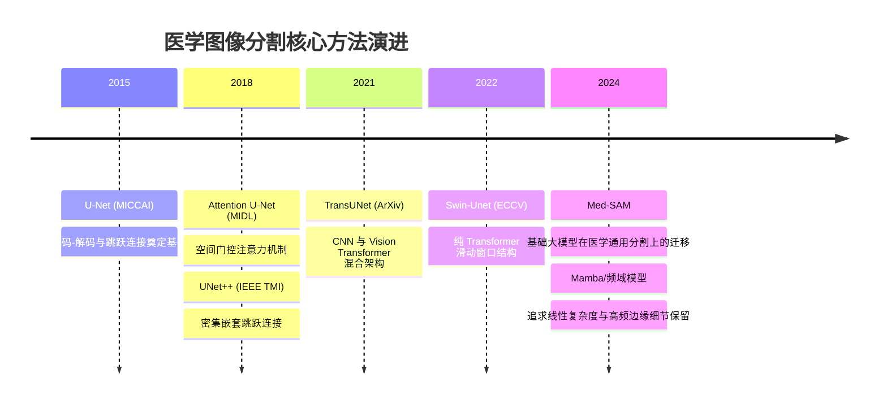

# 📖 医学图像分割顶刊文献综述与精读库

为了从国际权威顶刊中汲取算法设计灵感，并为课程论文（EI 检索标准）打下坚实的理论与文献对比基础，本库精选并下载了医学影像与深度学习领域的 **顶刊/划时代文献**，并使用专业学术翻译工具完成了 **中英双语对照 PDF** 的排版翻译。

---

## 🌟 顶刊精读专题索引 (Top Journal Reading List)

| 论文代号 | 顶刊名称 / 级别 | 论文题目与核心创新机制 | 详细精读笔记 | 原始 / 译本 PDF 直达 |
| :--- | :--- | :--- | :--- | :--- |
| **Paper-01** | **Nature Communications** (2024, IF: 14.7) | **MedSAM**: Segment Anything in Medical Images *(通用大模型在医学多模态 1.5M+ 数据的微调)* | [[Paper_01_MedSAM_NatComm2024]] | [英文原版](file:///d:/machine_learning/papers/original_en/2024_NatComm_MedSAM.pdf) [中英双语](file:///d:/machine_learning/papers/translated_zh/2024_NatComm_MedSAM-dual.pdf) |
| **Paper-02** | **IEEE TMI** (2020, IF: 8.9) | **UNet++**: Redesigning Skip Connections to Exploit Multiscale Features *(密集嵌套跳跃通道，弥合深浅层语义鸿沟)* | [[Paper_02_UNetPlusPlus_IEEE_TMI2020]] | [英文原版](file:///d:/machine_learning/papers/original_en/2020_IEEE_TMI_UNet++.pdf) [中英双语](file:///d:/machine_learning/papers/translated_zh/2020_IEEE_TMI_UNet++-dual.pdf) |
| **Paper-03** | **MedIA / MIDL** (2018, IF: 10.9) | **Attention U-Net**: Learning Where to Look for the Pancreas *(空间门控注意力机制，自适应抑制背景虚假响应)* | [[Paper_03_Attention_UNet_MIDL2018]] | [英文原版](file:///d:/machine_learning/papers/original_en/2018_Attention_UNet.pdf) [中英双语](file:///d:/machine_learning/papers/translated_zh/2018_Attention_UNet-dual.pdf) |
| **Paper-04** | **Medical AI Landmark** (Cited 4000+) | **TransUNet**: Transformers Make Strong Encoders for Medical Image Segmentation *(CNN 与 Vision Transformer 混合长程建模)* | [[Paper_04_TransUNet_2021]] | [英文原版](file:///d:/machine_learning/papers/original_en/2021_TransUNet.pdf) [中英双语](file:///d:/machine_learning/papers/translated_zh/2021_TransUNet-dual.pdf) |
| **Paper-05** | **Medical AI 前沿焦点** (2024-2025, 顶会热点) | **VM-UNet**: Vision Mamba UNet for Medical Image Segmentation *(状态空间模型SSM，打破Transformer二次方复杂度)* | [[Paper_05_VM_UNet_Mamba]] | [英文原版](file:///d:/machine_learning/papers/original_en/2025_VM-UNet_Mamba.pdf) [中英双语](file:///d:/machine_learning/papers/translated_zh/2025_VM-UNet_Mamba-dual.pdf) |

---

## 1. 经典架构演进脉络

---

## 2. 关键基线对比分析 (Baseline Comparison)

| 经典文献 / 模型 | 核心创新机制 | 显著优势 | 局限性与痛点（本论文攻克点） |
| :--- | :--- | :--- | :--- |
| **U-Net** (2015) | 编码器-解码器 + 纯对称 Skip Connection | 结构清晰，小样本鲁棒，泛化稳定 | 连续下采样造成高频信息永久丢失；对模糊边缘判别能力弱 |
| **Attention U-Net** (2018) | 引入粗粒度空间门控注意力 | 抑制非病灶背景区域的虚假响应 | 依赖浅层低抽象特征，缺乏明确的边缘高频频率先验引导 |
| **UNet++** (2018) | 重新设计密集网状跳跃通道 | 缩小编码器与解码器的语义鸿沟 | 参数冗余大，多层特征聚合计算复杂度显著增加 |
| **TransUNet** (2021) | 瓶颈层使用 ViT 捕获全局长程依赖 | 全局组织器官关系建模强 | 显存与算力开销大，微小边缘位置依然依赖 CNN 解码器 |
| **Swin-Unet** (2022) | 基于 Shifted Window 的分层 Transformer | 具备线性计算复杂度的长距离建模 | 缺乏局部高频归纳偏置（Inductive Bias），低对比度病灶易漏分割 |
| **Boundary Loss** (2019) | 引入表面距离与轮廓距离优化 | 显著纠正区域重叠损失对小边界的不敏感 | 传统轮廓损失计算复杂，难以直接端到端端梯度稳定传导 |

---

## 3. 本论文发现的研究缺口与创新启示 (Research Gap & Inspirations)
1. **空间域与频域的割裂**：目前绝大部分医学分割模型仅在空间域（Pixel/Feature space）做卷积和注意力，忽视了频域中小波变换对突变边缘和病灶轮廓的天然正交敏感性。
2. **边缘特征被动学习 vs 主动引导**：以往模型（如 UNet++, TransUNet）依靠深层解码器逐层推测边缘，缺乏显式的“高频先验-门控约束”闭环。
3. **精度与算力开销的权衡**：以 MedSAM 为代表的大模型参数量（>90M）无法在基层医疗或普通 GPU 上落地，而传统轻量模型又难以精准切出模糊边缘。

👉 **本课题提出的 FEE-Net 正式针对以上缺口，以离散小波频域高频分解 + 轻量边缘门控机制攻克模糊病灶边缘。**
