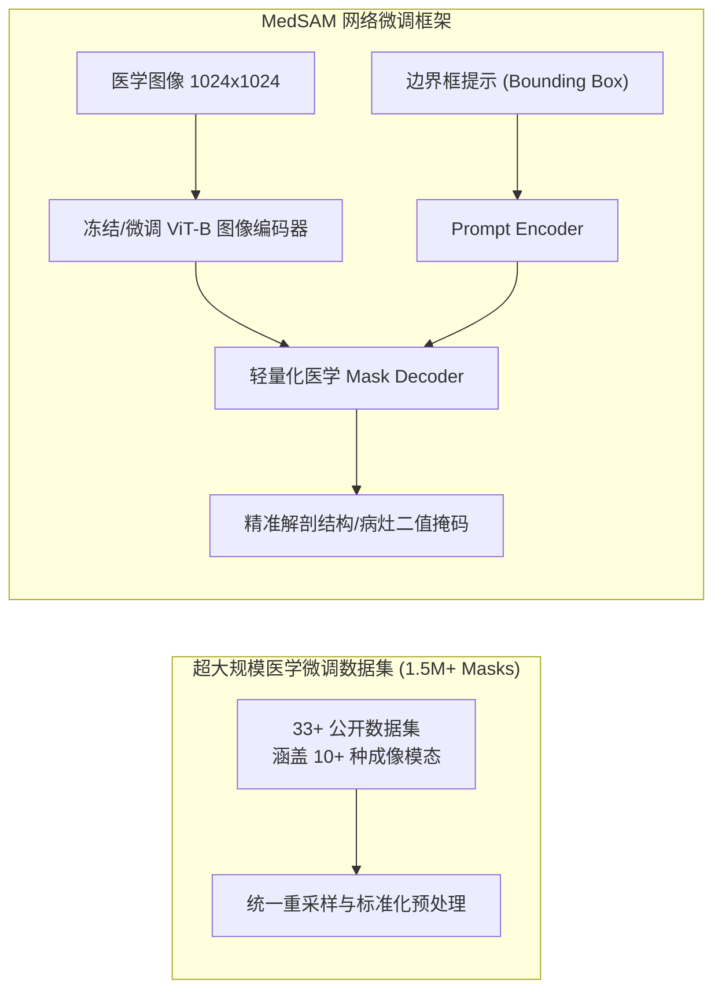

# 📑 顶刊精读：Segment Anything in Medical Images (MedSAM)

- **期刊/发表地**：Nature Communications (2024, 自然子刊/综合顶级期刊, IF: 14.7)
- **作者团队**：Jun Ma, Yuting He, Feifei Li, Lin Han, Chenyu You, Bo Wang (多伦多大学、哈佛大学等)
- **原文与译本**：
  - 📄 [查看英文原版 PDF](file:///d:/machine_learning/papers/original_en/2024_NatComm_MedSAM.pdf)
  - 🇨🇳 [查看中英双语对照 PDF (已由专业软件排版翻译)](file:///d:/machine_learning/papers/translated_zh/2024_NatComm_MedSAM-dual.pdf)
  - 🀄 [查看纯中文翻译版 PDF](file:///d:/machine_learning/papers/translated_zh/2024_NatComm_MedSAM-mono.pdf)

---

## 1. 论文核心动机与痛点 (Motivation & Problem)
- **通用大模型直接迁移医学影像的失效**：Meta 发布的 Segment Anything Model (SAM) 在自然图像（日常物体、风景、人像）上表现出惊人的零样本分割能力。然而在医学图像领域，直接使用 SAM 往往会出现严重衰退。
- **医学影像特异性**：医学图像包含 CT、MRI、超声 (US)、X 光、眼底、内窥镜、皮肤镜等 10+ 种完全不同的物理成像模态，病灶分布形态不规则、组织对比度低、器官拓扑结构复杂，自然图像预训练权重对医学低对比度边界严重不敏感。

---

## 2. 核心算法设计与数据构建 (Methodology & Pipeline)

### 2.1 架构微调策略
- 保持 SAM 的 ViT 编码器基础提取能力，同时解冻部分特征交互层。
- 重点对轻量 Mask Decoder 进行医学领域的针对性监督微调。
- 采用 **边界框 (Bounding Box)** 作为主要的交互提示（Prompt），因为临床医生在实际诊断中画框标注最快速、最符合工作流习惯。

### 2.2 损失函数设计
$$
\mathcal{L} = \mathcal{L}_{\text{BCE}}(P, Y) + \mathcal{L}_{\text{Dice}}(P, Y)
$$
在超 1,570,000 张包含三维切片与二维多模态影像的数据对上进行大规模分布式微调。

---

## 3. 本论文对我们课程/EI论文 (FEE-Net) 的设计启发 (Inspirations)
1. **大模型的短板是轻量化创新的契机**：
   - MedSAM 基于 ViT-B/L，参数量高达 **90M ~ 300M+**，单次推理需要高性能 GPU（显存 > 12GB），在普通医院基层设备、便携式超声仪或边缘端根本无法部署。
   - **这为我们的 FEE-Net 提供了极佳的论文立论依据**：我们在论文 Introduction 中可直接援引 MedSAM，指出“尽管大模型具备泛化性，但在资源受限场景下，需要参数量小于 8M、无需提示框的全自动超轻量分割网络”。
2. **边缘模糊与边界提示依赖**：
   - MedSAM 极度依赖外部人工框选的 Prompt（无 Prompt 时无法全自动分割）。而 **FEE-Net** 凭借频域小波的高频先验，能做到**完全无提示的全自动高精分割**。
