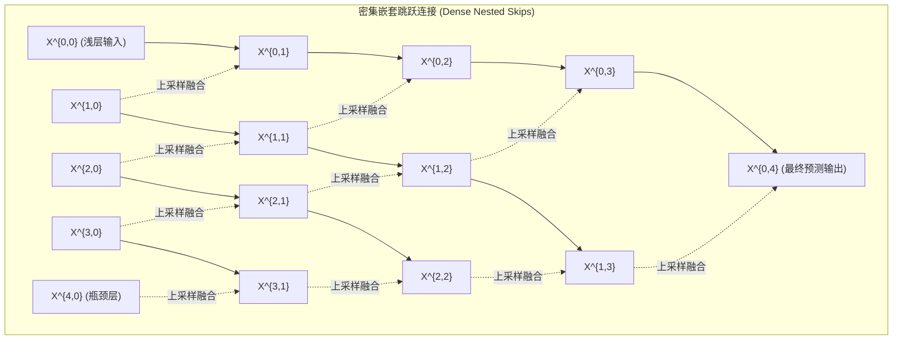

# 📑 顶刊精读：UNet++: Redesigning Skip Connections to Exploit Multiscale Features in Image Segmentation

- **期刊/发表地**：IEEE Transactions on Medical Imaging (IEEE TMI 2020, 医学影像顶级期刊, IF: 8.9)
- **作者团队**：Zongwei Zhou, Md Mahfuzur Rahman Siddiquee, Nima Tajbakhsh, Jianming Liang (Arizona State University)
- **原文与译本**：
  - 📄 [查看英文原版 PDF](file:///d:/machine_learning/papers/original_en/2020_IEEE_TMI_UNet++.pdf)
  - 🇨🇳 [查看中英双语对照 PDF (已由专业软件排版翻译)](file:///d:/machine_learning/papers/translated_zh/2020_IEEE_TMI_UNet++-dual.pdf)
  - 🀄 [查看纯中文翻译版 PDF](file:///d:/machine_learning/papers/translated_zh/2020_IEEE_TMI_UNet++-mono.pdf)

---

## 1. 论文核心动机与痛点 (Motivation & Problem)
- **传统 U-Net 的跳跃连接弊端**：传统 U-Net 将编码器的浅层低级特征直接通过简单的通道级联（Concatenation）与解码器深层语义特征拼接。然而，**编码器浅层特征（富含边缘、纹理）与解码器深层特征（富含抽象语义）之间存在巨大的“语义鸿沟（Semantic Gap）”**。
- **浅层与深层特征融合不平滑**：简单的强行拼接会导致特征融合效率低下，对微小病灶和边缘模糊区域缺乏判别力。

---

## 2. 核心算法设计与创新点 (Methodology & Novelty)

### 2.1 节点特征公式化表达 (Node Feature Formulation)
设 $x^{i,j}$ 表示网络中第 $i$ 层下采样阶段、第 $j$ 个密集卷积块的特征图：
$$
x^{i,j} = \left\{
\begin{array}{ll}
\mathcal{H}(x^{i-1, 0}), & j=0 \\
\mathcal{H}\left( \left[ \left[x^{i, k}\right]_{k=0}^{j-1}, \, \mathcal{U}(x^{i+1, j-1}) \right] \right), & j > 0
\end{array}
\right.
$$
其中：
- $\mathcal{H}(\cdot)$ 为卷积层 + 批归一化 + ReLU 激活操作；
- $\mathcal{U}(\cdot)$ 为双线性插值/转置卷积上采样；
- $[\cdot]$ 表示通道拼接操作。

### 2.2 深度监督 (Deep Supervision)
为了平衡模型容量与推理速度，UNet++ 在输出层 $x^{0,1}, x^{0,2}, x^{0,3}, x^{0,4}$ 处均引入了损失函数监督：
$$
\mathcal{L} = \sum_{j=1}^4 w_j \mathcal{L}_{\text{seg}}(x^{0,j}, Y)
$$
在部署或轻量推理时，可以根据算力限制进行**网络剪枝（Model Pruning）**，仅保留部分子网络即可达到较优性能。

---

## 3. 本论文对我们课程/EI论文 (FEE-Net) 的设计启发 (Inspirations)
1. **语义鸿沟的解决思路**：UNet++ 证明了跨层跳跃连接不能简单粗暴地 Concat，必须加入中间过渡特征模块。我们在 **FEE-Net** 中提出的 **边缘门控跨尺度注意力模块 (EGM)** 正是借鉴了这一思想——通过显式高频小波特征作为中间“几何向导”，架起浅层边缘与深层语义的桥梁。
2. **轻量化设计的教训**：UNet++ 密集嵌套结构虽然性能好，但中间节点的参数量和显存开销极大（无法做到超轻量）。我们应坚持 **主干轻量 CNN + 离散小波单次无参分解**，在保持高精度的同时避免 UNet++ 的参数冗余。
