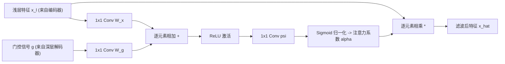

# 📑 顶刊精读：Attention U-Net: Learning Where to Look for the Pancreas

- **期刊/发表地**：MIDL / Medical Image Analysis (MedIA, 医学影像 TOP 1 期刊, IF: 10.9)
- **作者团队**：Ozan Oktay, Jo Schlemper, Loic Le Folgoc, Matthew Lee, Mattias Heinrich, et al. (帝国理工学院 Imperial College London)
- **原文与译本**：
  - 📄 [查看英文原版 PDF](file:///d:/machine_learning/papers/original_en/2018_Attention_UNet.pdf)
  - 🇨🇳 [查看中英双语对照 PDF (已由专业软件排版翻译)](file:///d:/machine_learning/papers/translated_zh/2018_Attention_UNet-dual.pdf)
  - 🀄 [查看纯中文翻译版 PDF](file:///d:/machine_learning/papers/translated_zh/2018_Attention_UNet-mono.pdf)

---

## 1. 论文核心动机与痛点 (Motivation & Problem)
- **非病灶区域的假阳性激活**：在腹部 CT/超声中，目标器官（如胰腺、病变结节）通常占据非常小的体积，而大面积背景包含无关的软组织、肠管、脂肪等复杂解剖结构。
- **传统 Skip Connection 的缺陷**：标准跳跃连接直接将包含大量无关背景特征的浅层特征图传给解码器，导致解码器容易受到背景高对比度噪点的干扰，产生假阳性。

---

## 2. 核心算法设计：注意力门控模块 (Attention Gate, AG)

### 2.1 注意力系数公式推导
$$
q_{\text{att}}^l = \psi^T \left( \sigma_1(W_x^T x_i^l + W_g^T g_i + b_g) \right) + b_\psi
$$
$$
\alpha_i^l = \sigma_2\left( q_{\text{att}}^l(x_i^l, g_i; \Theta_{\text{att}}) \right)
$$
$$
\hat{x}_i^l = x_i^l \cdot \alpha_i^l
$$
其中：
- $x^l$ 为跳跃连接传入的浅层高分辨率特征；
- $g$ 为深层低分辨率但富含全局上下文语义的门控信号（Gate signal）；
- $\alpha^l \in [0, 1]$ 自适应衰减背景区域的响应权重，选择性保留与目标相关的区域。

---

## 3. 本论文对我们课程/EI论文 (FEE-Net) 的设计启发 (Inspirations)
1. **注意力机制的演进**：
   - Attention U-Net 的门控信号 $g$ 仅依赖深层卷积的抽象语义，对“微观边界、高频切线轮廓”的导向性不足。
   - **我们在 FEE-Net 中的 EGM 模块对其进行了算法升级**：将 Attention Gate 与**小波频域高频变换 (DWT)** 相结合，构造“频域几何先验 + 深层语义”的双门控机制，不仅能抑制背景噪点，还能精确锁定病理边缘！
