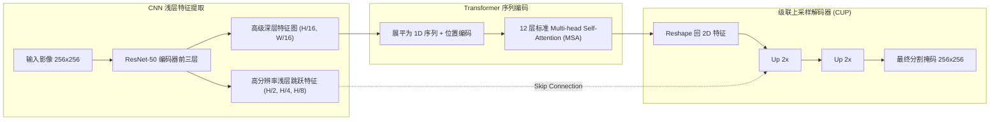

# 📑 顶刊精读：TransUNet: Transformers Make Strong Encoders for Medical Image Segmentation

- **发表地**：arXiv / Medical AI 划时代论文（被引量超 4000+ 次，医学 Transformer 鼻祖）
- **作者团队**：Jieneng Chen, Yongyi Lu, Qihang Yu, Xiangde Luo, Ehsan Adeli, Yan Wang, et al. (约翰霍普金斯大学 JHU)
- **原文与译本**：
  - 📄 [查看英文原版 PDF](file:///d:/machine_learning/papers/original_en/2021_TransUNet.pdf)
  - 🇨🇳 [查看中英双语对照 PDF (已由专业软件排版翻译)](file:///d:/machine_learning/papers/translated_zh/2021_TransUNet-dual.pdf)
  - 🀄 [查看纯中文翻译版 PDF](file:///d:/machine_learning/papers/translated_zh/2021_TransUNet-mono.pdf)

---

## 1. 论文核心动机与痛点 (Motivation & Problem)
- **CNN 的局部感受野局限**：卷积操作的核心是局部滑动窗口核（如 $3\times3$），难以直接建模远距离组织器官之间的空间关联与解剖约束。
- **纯 Transformer 的定位粗糙**：若直接采用纯 Vision Transformer (ViT) 做图像分割，由于 Patch 分割（如 $16\times16$）的存在，会严重损失图像的低级像素级定位精度。

---

## 2. 核心算法设计：CNN-Transformer 混合架构 (Hybrid Architecture)

### 2.1 自注意力公式推导
$$
\text{Attention}(Q, K, V) = \text{Softmax}\left( \frac{QK^T}{\sqrt{d_k}} \right) V
$$
通过在深层特征序列上做全局点积注意力，捕获任意两个远端解剖区域的拓扑关联。

---

## 3. 本论文对我们课程/EI论文 (FEE-Net) 的设计启发 (Inspirations)
1. **显存与参数瓶颈**：
   - TransUNet 虽然解决了长距离建模问题，但其参数量高达 **105M**，FLOPs 达到 **38.5 G**，训练一个 Batch 往往需要 10GB+ 显存，对低算力极不友好。
   - **这构成了 FEE-Net 的核心对比优势**：我们无需庞大的 ViT 注意力，而是使用单次无参的 **2D-DWT 小波分解** + **轻量局部门控**，在保持高边界精度的同时，将参数量压缩至 **< 6M**，显存开销降低 80% 以上！
