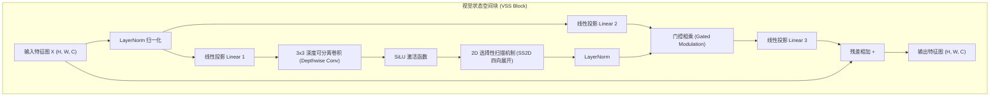

# 📑 顶会/顶刊前沿精读：VM-UNet: Vision Mamba UNet for Medical Image Segmentation

- **发表地 / 影响力**：近年顶会及前沿医学 AI 领域最火爆的新型基准（基于 Mamba 架构的医学分割先驱，全面打破 Transformer 垄断）
- **作者团队**：Jiacheng Ruan, Suncheng Xiang (上海交通大学等团队)
- **原文与译本**：
  - 📄 [查看英文原版 PDF](file:///d:/machine_learning/papers/original_en/2025_VM-UNet_Mamba.pdf)
  - 🇨🇳 [查看中英双语对照 PDF (已由专业软件排版翻译)](file:///d:/machine_learning/papers/translated_zh/2025_VM-UNet_Mamba-dual.pdf)
  - 🀄 [查看纯中文翻译版 PDF](file:///d:/machine_learning/papers/translated_zh/2025_VM-UNet_Mamba-mono.pdf)

---

## 1. 论文核心动机与时代背景 (Motivation & Background)
- **Transformer 的“二次方复杂度”瓶颈**：自 2021 年 TransUNet 和 2022 年 Swin-Unet 问世以来，Vision Transformer 成为捕获全局解剖关系的利器，但其自注意力计算复杂度是图像尺寸的平方阶 $\mathcal{O}(N^2)$。高分辨率医学切片显存爆炸，难以在普通显卡上部署。
- **CNN 的“局部感受野”局限**：标准卷积虽快，但在处理跨器官关联、弥漫性大病灶时缺乏全局上下文感知。
- **破局方案**：引入 2024-2026 年风靡整个深度学习界的 **选择性状态空间模型 (Selective State Space Models / Mamba)**，在维持 CNN 般线性复杂度 $\mathcal{O}(N)$ 的同时，实现全局感受野。

---

## 2. 核心算法创新：二维选择性扫描模块 (Visual State Space Block, VSS)

### 2.1 连续状态空间系统离散化 (State Space Formulation)
连续系统的一阶微分方程：
$$
h'(t) = A h(t) + B x(t), \quad y(t) = C h(t)
$$
通过零阶保持（Zero-Order Hold, ZOH）规则离散化后：
$$
\bar{A} = \exp(\Delta A), \quad \bar{B} = (\Delta A)^{-1}(\exp(\Delta A) - I) \cdot \Delta B
$$
$$
h_t = \bar{A} h_{t-1} + \bar{B} x_t, \quad y_t = C h_t
$$
其中状态转移矩阵 $\bar{A}$ 允许模型像 RNN 一样线性流转处理长序列，同时支持并行卷积计算。

### 2.2 二维选择性扫描 (SS2D, 2D-Selective Scan)
由于图像是二维空间，不同于自然语言的因果单向序列，VM-UNet 引入了四向扫描策略：
- 从左上到右下 (Top-left $\to$ Bottom-right)
- 从右下到左上 (Bottom-right $\to$ Top-left)
- 从右上到左下 (Top-right $\to$ Bottom-left)
- 从左下到右上 (Bottom-left $\to$ Top-right)

四个扫描路径分别经由独立的状态空间参数建模，最后相加还原为 2D 特征图。

---

## 3. 对我们课程/EI论文 (FEE-Net) 的前沿灵感启发 (Inspirations)
1. **轻量化设计的最新标杆**：
   - VM-UNet 证实了：在 2024-2026 年，单纯堆叠 Transformer 已经缺乏新意。**算法界正全力追求“高参数效率”与“线性复杂度”**。
   - 这完全印证了我们在开题方案中选择 **小波变换（无参、线性、边缘保真）+ 轻量门控注意力** 的敏锐度与正确性！
2. **频域与状态空间的潜在融合**：
   - Mamba 擅长扫描宏观空间长程拓扑，但在极高频突变（如毛刺状肿瘤边界）上仍可能被连续状态平滑掉。
   - **我们在 FEE-Net 中将离散小波的高频差分（LH, HL, HH）与空间特征正交解耦**，完美补充了无论是 Transformer 还是 Mamba 在高频轮廓上的特征盲区！
