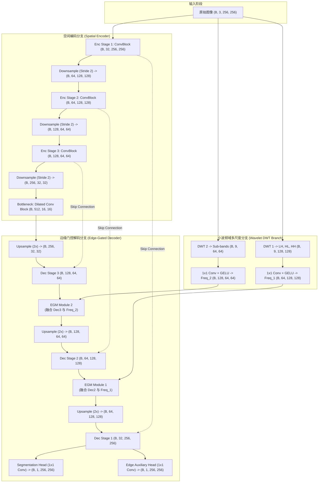

# 🏗️ FEE-Net 详细网络架构与数据流

本笔记记录 FEE-Net 的模块划分、张量尺寸流转与连接拓扑。

---

## 1. 网络全局数据流图

---

## 2. 关键模块张量规范

| 阶段 | 模块输入 | 输出特征尺寸 (以 Batch=8 为例) | 关键层说明 |
| :--- | :--- | :--- | :--- |
| **Input** | Raw Image | `[8, 3, 256, 256]` | 归一化医学图像 |
| **Enc 1** | Input | `[8, 32, 256, 256]` | $3\times3$ Depthwise Separable Conv |
| **DWT 1** | Input | `[8, 9, 128, 128]` | Haar 小波 3 个高频子带（无参数卷积） |
| **Enc 2** | Enc 1 下采样 | `[8, 64, 128, 128]` | 残差卷积块 |
| **Enc 3** | Enc 2 下采样 | `[8, 128, 64, 64]` | 残差卷积块 |
| **Bottleneck** | Enc 3 下采样 | `[8, 256, 32, 32]` | 空洞卷积（膨胀率 2, 4）扩大感受野 |
| **EGM 2** | Dec 3 & Freq 2 | `[8, 128, 64, 64]` | 频域边缘先验门控注意力 |
| **EGM 1** | Dec 2 & Freq 1 | `[8, 64, 128, 128]` | 频域边缘先验门控注意力 |
| **Final Seg**| Dec 1 输出 | `[8, 1, 256, 256]` | Sigmoid 激活输出病灶二值分割掩码 |
| **Final Edge**| Dec 1 输出 | `[8, 1, 256, 256]` | 辅助监督：病灶边缘轮廓图 |
