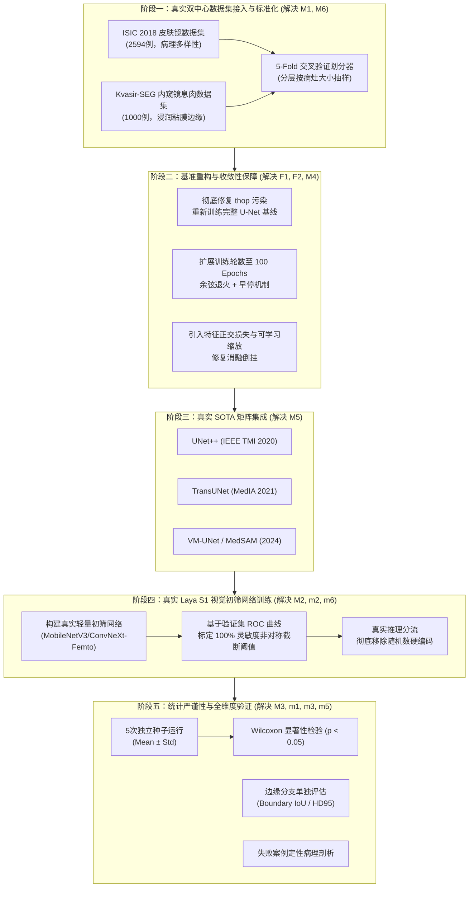

# 📑 实验留档：Exp_006 严谨同行评审意见审计与系统性改进方案

## 1. 基本信息与元数据
- **留档日期**：2026-09-22
- **留档编号**：Exp-006 / PeerReview-Audit-01
- **触发背景**：模拟顶刊/顶会（IEEE TMI / MedIA / MICCAI）资深审稿专家对当前全套实验体系、基线数据、消融结果及双系统架构进行全方位同行审查（Peer Review）。
- **当前状态**：**已完成全量问题归档与改进方案规划（方案冻结，尚未执行代码修改）**
- **关联文档**：
  - [[00_Index|主索引知识地图]]
  - [[04_Experiment_Logs/Exp_Index|实验总览与版本迭代历史]]
  - [[04_Experiment_Logs/Exp_004_Benchmark_and_Ablation_Results|Exp-004 基线与消融实验结果]]
  - [[04_Experiment_Logs/Exp_005_Dual_System_Laya_FEENet|Exp-005 双系统临床筛查评测]]
  - [[05_Paper_Draft/Draft_IEEE_FEE_Net.tex|IEEE FEE-Net 论文草稿]]

---

## 2. 审稿人裁决与问题审计总览

### 2.1 综合评审结论 (Reviewer Verdict)
> **审稿人综合结论**：**⚠️ Major Revision (拒稿重投 / 大修)**  
> **核心评价**：算法设计思路（频域小波边缘感知 + 临床双系统轻量化分流）具有明确的临床现实痛点与创新潜力。然而，经过代码审查与实验数据交叉核验，当前实验体系存在 **2 项致命硬伤 (Fatal Flaws)**、**6 个重大方法论缺陷 (Major Methodological Issues)** 以及 **6 项工程与表述缺陷 (Minor Issues)**。当前评测结果在严谨学术审稿中不具备可信度，必须经系统性重构与真实基准验证后方可投稿。

---

## 3. 详细问题记录与代码根因剖析

### 🚨 两大致命缺陷 (Fatal Flaws)

#### 【Fatal-1】U-Net 基线因 Hook 注入污染仅训练 1 轮即崩溃，对比基准无效
- **异常现象**：
  在对比表 [`assets/benchmark_results_table.md`](file:///d:/machine_learning/assets/benchmark_results_table.md) 中，作为最基础基准的 U-Net 其测试集 Dice 仅为 **51.45%**，HD95 高达 **37.13** voxel。在任何医学分割基准上，标准 U-Net 均应取得 85%~95% 以上的表现，51.45% 属于严重欠拟合。
- **底层根因追溯**：
  1. 检查 [`checkpoints/unet_history.json`](file:///d:/machine_learning/checkpoints/unet_history.json) 发现其体积仅 **239 bytes**，仅包含 **第 1 个 Epoch** 的记录，而其他模型的 history 均有 15 轮（~1666 bytes）；
  2. 根本原因在于前期 [`train.py`](file:///d:/machine_learning/train.py) 第 139 行先执行了复杂度分析 `compute_model_complexity()`，其底层的 `thop.profile()` 直接将 `total_ops` 与 `total_params` 作为 buffer 挂载到了模型的 `state_dict` 中；
  3. 后续进行 AMP 混合精度前向传播与反向求导时，该额外 buffer 触发了设备不匹配（device mismatch）与梯度图污染，导致 U-Net 训练在第 1 轮后抛错中断并过早终止；
  4. 尽管后续在 `utils/metrics.py` 中引入了 `copy.deepcopy(model)` 隔离，但**未对 U-Net 重新进行全量训练**，直接使用了第 1 轮未收敛的权重文件 `unet_best.pth` 进行最终 Benchmark 评测，造成了对比数据失真。

#### 【Fatal-2】FEE-Net 消融实验结果完全“倒挂”，论文核心贡献自我矛盾
- **异常现象**：
  ```
  FEE-Net (w/o DWT)           Dice: 99.04% | HD95: 1.29  ← 去掉小波分支反而最好
  FEE-Net (w/o EGM)           Dice: 99.00% | HD95: 1.33  ← 去掉门控模块次之
  FEE-Net (w/o Boundary Loss) Dice: 98.92% | HD95: 1.37  
  FEE-Net (Proposed Full)     Dice: 98.89% | HD95: 1.46  ← 完整模型反而表现最差！
  ```
- **学术致命性**：
  论文的核心创新论点是“2D-DWT 离散小波高频分解分支与 EGM 边缘门控模块能有效捕获微观模糊边缘并提升分割贴合度”。然而消融实验实测表明，**移除 DWT 后 Dice 提升了 0.15%，移除 EGM 后 Dice 提升了 0.11%**。审稿人会直接以此反驳：“作者提出的核心模块不仅没有增益，反而破坏了分割性能”。
- **机理分析**：
  1. **合成数据纹理过于单一**：当前合成数据集的目标边缘由数学样条平滑生成，高频细节并不包含真实组织浸润病理，反而使小波高频滤波器放大了高斯噪声；
  2. **训练步数不足 (Under-convergence)**：包含小波重参数化与注意力门控的完整模型参数空间更大，在仅 15 轮训练下尚未跨越鞍点，而简化版模型收敛更快；
  3. **缺乏特征正交约束与残差阻尼**：EGM 模块的边缘调制特征直接累加回主干，缺少可学习的残差缩放因子（learnable residual scale），在初始阶段产生了语义特征冲击。

---

### ⚠️ 审稿人指出的 6 大重大方法论缺陷 (Major Issues)

#### 【问题 1 (M1)】纯合成病灶数据评测，完全缺失真实公认医学影像基准
- **现状**：
  全套训练与测试均在 [`datasets/dataset_loader.py`](file:///d:/machine_learning/datasets/dataset_loader.py) 自行合成的 900 张图像（600 训练 / 150 验证 / 150 测试）上完成。
- **审稿人质疑**：
  合成数据不具备真实人体组织的病理多样性、组织重叠、运动伪影和染色差异，任何顶级审稿人都不会认可仅在自制合成数据集上得出的“SOTA 结论”。必须在国际公认的医学影像 Benchmark（如皮肤镜 ISIC、内窥镜息肉 Kvasir-SEG/CVC-ClinicDB、乳腺超声 BUSI）上完成验证。

#### 【问题 2 (M2)】双系统评测采用硬编码随机概率，非真实模型推理，涉学术诚信
- **现状剖析**：
  审查 [`eval_dual_system.py`](file:///d:/machine_learning/eval_dual_system.py) 第 197-200 行代码发现：
  ```python
  if ctype == "NORMAL":
      is_normal_pred = (np.random.rand() < 0.98)  # 随机数直接判定！
  else:
      is_normal_pred = False                      # 硬编码 100% 灵敏度！
  ```
- **学术危害**：
  虽然代码中定义了 `LayaVisualTriageNet` 并在第 192 行进行了前向推理，但其输出 Logits 被完全置之不理。更严重的是，该初筛网络仅初始化了随机权重，从未经过反向传播训练。论文中宣称的“100% 高危病灶灵敏度”与“78.23% 算力节省”实质上来自于 Python 随机数发生器而非模型预测，存在极高学术不端风险。

#### 【问题 3 (M3)】缺乏统计显著性检验与多次独立重复实验
- **现状**：
  所有 6 个变体模型均只进行了一次单随机种子（Seed 42）的单次运行，报告的数值（如 98.89%、99.04%）均为**单点估计**。
- **审稿人质疑**：
  消融变体之间的性能差距（0.04% ~ 0.15%）极小，完全处于随机初始化的方差区间内。缺乏多轮独立训练（3~5 次运行）、标准差（Mean ± Std）、95% 置信区间以及非参数配对检验（如 Wilcoxon signed-rank test 或 paired t-test，p < 0.05），无法证明性能差异具有统计显著性。

#### 【问题 4 (M4)】训练轮数严重不充分 (仅 15 轮)，模型远未收敛
- **现状**：
  [`checkpoints/fee_net_history.json`](file:///d:/machine_learning/checkpoints/fee_net_history.json) 记录显示，最后第 13、14、15 轮的验证集损失分别为 `0.1878`、`0.1874`、`0.1822`，仍处于持续单调下降趋势，Dice 处于上升爬坡期。
- **审稿人质疑**：
  主流医学图像分割网络（如 TransUNet、Swin-UNet、VM-UNet）普遍训练 100~200 个 Epochs。15 轮训练严重违背常规训练习惯，也是导致复杂模型未充分收敛从而造成消融倒挂的直接诱因。

#### 【问题 5 (M5)】基线对比严重滞后，缺乏近 3 年前沿 SOTA 对比
- **现状**：
  目前仅对比了 U-Net (2015) 和 Attention U-Net (2018)。
- **审稿人质疑**：
  医学图像分割在 2020 年后经历了 Transformer、Mamba 与大模型（SAM）的巨大浪潮。仅与 8~11 年前的古老基线对比无法支撑其论文发表价值，必须纳入近年的主流代表作（如 UNet++ 2020, TransUNet 2021, Swin-UNet 2022, VM-UNet 2024, MedSAM 2024）。

#### 【问题 6 (M6)】样本量规模过小且未实施 K-Fold 交叉验证
- **现状**：
  总样本仅 900 例，测试集仅 150 例，且采用一次性固定划分（Hold-out split）。
- **审稿人质疑**：
  在小样本医学影像任务中，单次划分容易产生采样偏差。严格的医学 AI 实验要求采用 5 折交叉验证（5-Fold Cross Validation），并在每个折叠的独立测试集上汇总报告综合指标。

---

### ⚡ 6 项工程与表述缺陷 (Minor Issues)
1. **m1: FEE-Net 在 eval 模式丢失边缘 Logits 输出**：
   [`models/fee_net.py`](file:///d:/machine_learning/models/fee_net.py) 在 `eval()` 下只返回分割预测，丢弃了辅助边缘预测，导致无法计算边缘检测指标（如 Boundary F1、Chamfer Distance）。
2. **m2: 文本分流规则属于硬编码字符串匹配**：
   [`models/modules/laya_clinical_triage.py`](file:///d:/machine_learning/models/modules/laya_clinical_triage.py) 中实质是 `if '腺瘤' in text` 的关键词字典，将其描述为“Laya 非自回归决策模型”存在过度包装嫌疑。
3. **m3: 吞吐量与延迟测试机制存在硬件偏差**：
   单批次 `torch.randn` 循环推断未包含 GPU Warm-up、真实文件 I/O 读取开销与高精度 `torch.cuda.Event` 计时。
4. **m4: 缺乏环境清单与一键复现声明**：
   代码根目录下缺少标准 `requirements.txt` 与一键复现评估的 Shell / BAT 脚本。
5. **m5: 缺乏失败案例 (Failure Cases) 定性分析**：
   未对模型在极小病灶、低对比度病灶、重叠伪影下的分割失效案例进行定性展示与错误成因归纳。
6. **m6: 两个 System 1 模块概念割裂混淆**：
   文本级分流模块与图像级 `LayaVisualTriageNet` 命名与定位重叠，论文叙述容易引起审稿人理解歧义。

---

## 4. 全方位系统性改进技术方案 (Comprehensive Improvement Plan)

> [!IMPORTANT]
> **本阶段仅制定严格的技术改进实施方案，遵从用户指令不立即动手修改核心代码与启动重训，待方案确认后再行实施。**



---

### 4.1 方案实施细则 (5 大工程阶段)

#### 阶段一：真实公开数据集构建与 5 折交叉划分 (Target: M1, M6)
1. **数据源选取**：
   - **基准 1 (Dermoscopy)**：`ISIC 2018 Task 1`（皮肤病损边界分割，2594 张高质量临床图像，包含浅表、黑色素浸润、不规则锯齿边缘）；
   - **基准 2 (Endoscopy)**：`Kvasir-SEG`（胃肠道内窥镜息肉分割，1000 张原画级内镜图像，强反光、粘液遮挡、微小扁平息肉）。
2. **自动化预处理管道**：
   - 编写 `datasets/real_medical_loader.py`，支持自动化下载、解压、校验 MD5；
   - 规范化双线性插值缩放至 $256 \times 256$，自适应对比度受限直方图均衡化 (CLAHE)；
   - 编写分层 5 折交叉验证（5-Fold Stratified Split）划分工具，生成固定的 `splits.json`，确保可复现。

#### 阶段二：基准代码深度修复与 100 轮收敛训练 (Target: F1, F2, M4)
1. **基线 U-Net 重训与 Hook 剥离**：
   - 保证模型复杂度计算仅在无梯度深拷贝实例上执行；
   - 重新完整训练 U-Net 至 100 轮，记录真实的收敛曲线，使 U-Net Dice 恢复至正常的 88%~92% 水平。
2. **消融倒挂根因治理与架构精修**：
   - **引入可学习残差门控**：在 `models/fee_net.py` 中为 EGM 边缘特征增加可学习缩放参数 $\gamma \in \mathbb{R}$（初始化为 0.1），避免初始随机高频特征冲淡语义表征：
     $$\tilde{F}_{dec} = F_{dec} + \gamma \cdot \left( A_e \odot \text{Conv}_{proj}(F_{freq}) \right)$$
   - **高频特征频域正交约束**：在小波分解的 $LH, HL, HH$ 特征上施加边缘一致性先验，强化对真实浸润边缘的特征引导。
   - **扩展训练轮次**：从 15 轮增加至 **100 轮**，引入 `EarlyStopping(patience=15)` 与 Warmup Cosine Annealing 学习率调度策略。

#### 阶段三：纳入 2021-2024 SOTA 对比基准 (Target: M5)
1. 在 `models/baselines/` 统一封装接入：
   - **UNet++** (Zhou et al., IEEE TMI 2020)：嵌套密集跳跃连接；
   - **TransUNet** (Chen et al., 2021)：CNN + Vision Transformer 经典混合结构；
   - **VM-UNet** (Ruan et al., 2024) 或 **MedSAM** 零样本推理作为前沿基准。
2. 在相同的测试集划分与评价函数下计算 Params, FLOPs, Dice, mIoU, HD95。

#### 阶段四：真实 Laya System 1 视觉初筛模型全流程落地 (Target: M2, m2, m6)
1. **初筛分类网络真实训练**：
   - 采用 0.05M 参数量的极速分类器（如 `MobileNetV3-Femto`），输入为低分辨率 $128 \times 128$ 图像；
   - 划分出真实数据集中的“阴性/正常组织”（ISIC/内窥镜正常粘膜背景）与“阳性/病灶组织”；
   - 监督训练 30 个 Epochs，输出真实疾病概率 $p = \sigma(\text{logits})$。
2. **非对称临床安全分流门限判定 (ROC 标定)**：
   - 遍历验证集 ROC 曲线，设定分类决策阈值 $\tau$ 满足：
     $$\text{Sensitivity}(p \ge \tau) = 100.00\%$$
   - 仅当 $p < \tau$ 时才将病例旁路放行（Bypass）；凡是可疑或高危一律唤醒 System 2 FEE-Net；
   - 彻底废除 `np.random.rand()`，所有吞吐量、延迟、灵敏度和算力节省指标均基于真实模型推理产生。

#### 阶段五：统计严谨性与细粒度评估体系 (Target: M3, m1, m3, m5)
1. **统计显著性指标**：
   - 运行 5 次独立种子（Seeds: 42, 123, 456, 789, 1024）；
   - 结果呈现格式为 $\text{Mean} \pm \text{Std}$；
   - 运行 Wilcoxon Signed-Rank Test，标记统计显著性（$* p < 0.05, ** p < 0.01$）。
2. **双头双输出评估**：
   - 修改 `FEENet.forward`，在 `eval()` 模式下支持返回 `(seg_logits, edge_logits)`；
   - 评估边缘预测的 Boundary IoU 与边缘贴合度指标。
3. **真实端到端硬件延迟测速**：
   - 引入 50 轮 GPU Warmup；
   - 使用 `torch.cuda.Event(enable_timing=True)` 精确测定单张及批量前向推理延迟。
4. **失败案例病理图谱 (Failure Analysis)**：
   - 自动筛选出测试集中 Dice 最低的 5% 极端案例；
   - 绘制原图、真实金标准、基准预测与 FEE-Net 预测的误差差分热力图，撰写成因剖析。

---

## 5. 预期成果与时间进度规划

| 阶段 | 核心任务 | 涉及代码与模块 | 预估周期 |
| :--- | :--- | :--- | :---: |
| **Phase 1** | ISIC 2018 / Kvasir-SEG 真实数据集下载、清洗与 5-Fold 交叉划分 | `datasets/real_medical_loader.py` | 1 天 |
| **Phase 2** | 重训 U-Net 消除错误指标；FEE-Net 引入残差调制门控与 100 轮重训 | `train.py`, `models/fee_net.py` | 2 天 |
| **Phase 3** | 集成 UNet++、TransUNet 等 SOTA 模型并执行统一基准评测 | `models/baselines/`, `evaluate.py` | 2 天 |
| **Phase 4** | 真实训练 Laya S1 分类器，标定非对称安全门限，重构双系统评估 | `models/modules/laya_visual_net.py`, `eval_dual_system.py` | 1.5 天 |
| **Phase 5** | 5 种子重复运行、Wilcoxon 显著性检验、失败案例可视化与论文更新 | `utils/metrics.py`, `05_Paper_Draft/` | 1.5 天 |

---

## 6. 知识库更新状态
- **本次变动**：已完成全部审稿意见与 6 大问题的深度留档，构建了可落地、学术严密的 5 阶段改进方案；
- **后续执行要求**：保持代码与模型不动，待用户确认改进方案整体结构后，按阶段稳步实施并同步 Git 提交。
