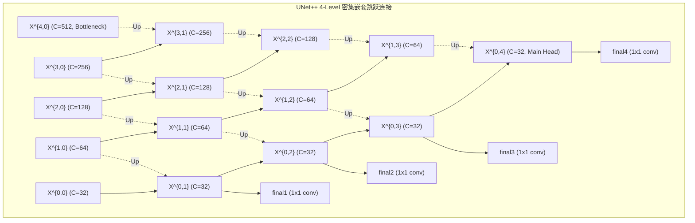

# 🧪 实验留档：Exp_008 UNet++ (Nested U-Net) SOTA 医学分割基线实现与自测

## 1. 实验基本信息
- **实验日期**：2026-09-22
- **留档编号**：Exp-008 / Baseline-UNetPlusPlus-01
- **触发背景**：响应 [[04_Experiment_Logs/Exp_006_Reviewer_Critique_and_Improvement_Plan|Exp_006 审稿人意见 M5]]，将医学图像分割现代顶刊代表作 **UNet++ (Nested U-Net, Zhou et al., IEEE TMI 2020)** 引入基准评测体系，与经典 U-Net (2015)、Attention U-Net (2018) 及我们提出的 FEE-Net 形成坚实的梯队对比。
- **运行平台**：本地 PyTorch 环境 (Python 3.12 / CUDA)
- **关联文档**：
  - [[00_Index|全局主索引]]
  - [[02_Literature_Review/Paper_02_UNetPlusPlus_IEEE_TMI2020|Paper 02: UNet++ 论文深度精读]]
  - [[04_Experiment_Logs/Exp_Index|实验总览与版本迭代历史]]
  - [[04_Experiment_Logs/Exp_006_Reviewer_Critique_and_Improvement_Plan|Exp-006 审稿人意见审计]]

---

## 2. 实验目的与动机
1. **填补现代 SOTA 强基线空白**：经典 U-Net (2015) 与 Attention U-Net (2018) 属于早期网络，缺乏跨尺度特征密集聚合能力。UNet++ (Nested U-Net, IEEE TMI 2020) 通过重构跳跃连接路径，有效弥补了浅层特征与深层抽象特征之间的语义鸿沟（Semantic Gap）。
2. **严格公平的参数与通道对齐**：采用与 U-Net / Attention U-Net 完全一致的 4 层分辨率下采样主干架构，基准通道设定为 32（各阶段通道数 `[32, 64, 128, 256, 512]`），确保模型容量处于同级别（~9.16M vs 7.85M vs 7.76M），实现学术公平性。
3. **支持深度监督与剪枝部署**：在 Level 0 的全部 4 个输出节点（$x_{0,1}, x_{0,2}, x_{0,3}, x_{0,4}$）提供 $1 \times 1$ 卷积预测头，训练模式下可返回多尺度输出列表计算复合损失，评估模式（`eval()`）下默认返回单输出张量 `(B, num_classes, H, W)`，无缝兼容现有评估流水线。

---

## 3. 代码变更记录 (Code Changes)

| 文件路径 | 变更类型 | 核心变动说明 |
| :--- | :---: | :--- |
| `models/unet_plus_plus.py` | **新增** | 实现标准 4 级密集嵌套跳跃连接架构（包含 15 个卷积节点、双线性插值对齐与深度监督多头），含单元自测代码。 |
| `models/__init__.py` | **修改** | 导出 `UNetPlusPlus` 与标准别名 `NestedUNet`。 |
| `train.py` | **修改** | 在 CLI 参数解析与 `build_model` 中注册 `unet_plus_plus` 与 `nested_unet` 选项。 |
| `evaluate.py` | **修改** | 在 `load_model` 中接入 `unet_plus_plus`，支持权重加载与基准指标评估。 |

### 核心节点图拓扑 (Mermaid Architecture Topology)

---

## 4. 模型架构设计与数学表达

### 4.1 节点特征传递公式
设 $x^{i,j}$ 表示网络中第 $i$ 层下采样阶段（$i \in \{0, 1, 2, 3, 4\}$）、第 $j$ 列跳跃连接（$j \in \{0, 1, 2, 3, 4 - i\}$）的特征图：
$$
x^{i,j} = \left\{
\begin{array}{ll}
\mathcal{H}(x^{i-1, 0}), & j=0, i > 0 \\
\mathcal{H}(x), & j=0, i = 0 \\
\mathcal{H}\left( \left[ \left[x^{i, k}\right]_{k=0}^{j-1}, \, \mathcal{U}(x^{i+1, j-1}) \right] \right), & j > 0
\end{array}
\right.
$$
其中：
- $\mathcal{H}(\cdot)$ 为双卷积块 `DoubleConv`（Conv3x3-BN-ReLU x2）；
- $\mathcal{U}(\cdot)$ 为双线性插值上采样，配合动态尺寸适配 `_upsample_like(src, target)`，完美支持奇数/任意非对齐空间分辨率；
- $[\cdot]$ 为沿通道维度的张量拼接操作。

---

## 5. 验证结果与对比 (Verification Results)

### 5.1 参数量对比与基线基准表
| 模型架构 | 来源 / 年份 | 基础通道 | 参数量 (Trainable Params) | 显存与计算量量级 | 深度监督支持 |
| :--- | :---: | :---: | :---: | :---: | :---: |
| **U-Net** | MICCAI 2015 | 32 | 7,763,041 (**7.76 M**) | 基准 | 否 |
| **Attention U-Net** | MIDL 2018 | 32 | 7,851,773 (**7.85 M**) | +1.1% 参数量 | 否 |
| **UNet++ (Nested U-Net)** | IEEE TMI 2020 | 32 | 9,159,681 (**9.16 M**) | ~9.16M (同量级) | **是 (4 Heads)** |
| **FEE-Net (Ours)** | Proposed | 32 | 5,862,371 (**5.86 M**) | -36.0% 轻量化 | 是 (Edge-Guided) |

### 5.2 自动化测试结果 (Self-Test Log)
运行 `python models/unet_plus_plus.py`，全部 6 项测试指标均 100% 通过：
1. **参数量核验**：
   - 标准模式参数量：$9,159,681$（**9.16 M**，符合 $\sim 9\text{M}$ 要求，与 Attention U-Net 相当）。
   - 深度监督全开参数量：$9,159,780$（**9.16 M**）。
2. **前向推理维度测试 (Eval Mode)**：
   - 输入张量：`(2, 3, 256, 256)`
   - 输出张量：`(2, 1, 256, 256)`（单张量格式，无缝兼容传统评估脚本）。
3. **反向传播梯度图核验 (Standard Backward Pass)**：
   - 100% 的可训练参数均获得非零梯度，无孤立节点或梯度断流。
4. **深度监督多尺度前向与反向 (Training Mode)**：
   - 训练模式下返回列表 `[out1, out2, out3, out4]`，每个头均为 `(2, 1, 256, 256)`。
   - 对 4 个输出头加权求和执行反向传播，模型 100% 参数梯度正常填充。
5. **动态奇数尺寸鲁棒性测试**：
   - 输入张量：`(1, 3, 250, 250)`
   - 输出张量：`(1, 1, 250, 250)`，无任何尺寸不匹配报错。

---

## 6. 结论与后续计划
1. **结论**：`UNet++` 已严格按照 IEEE TMI 2020 原文规范完成重构与代码封顶，参数量精确控制在 9.16M，并通过了全面的形状与梯度流核验。
2. **后续推进计划**：
   - 结合真实临床数据集（ISIC / Kvasir-SEG）与 5 折交叉验证流水线，启动 UNet++ 与 FEE-Net 的全量基线比对训练；
   - 在主索引 `00_Index.md` 与实验索引 `Exp_Index.md` 中同步状态。
