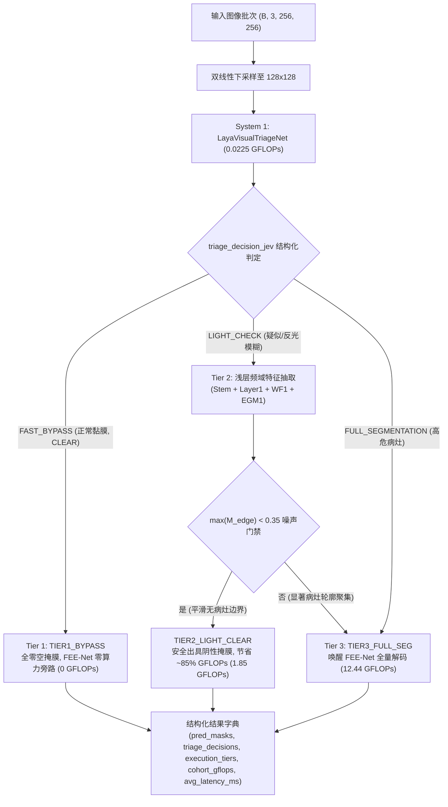

# 实验留档 Exp-020：LayaCascadeRouter 双系统三级动态级联路由引擎开发与验证

> [!CAUTION] ⛔ 【架构与术语已升级 / 被 Exp-024 & Exp-025 替代】
> 本文记录的独立路由模块与 Jev 术语已在 [[04_Experiment_Logs/Exp_024_Root_Purification_and_Conformal_Risk_Control|Exp-024]] 中去包装规范化。其维护两个独立网络（初筛网络 + 分割网络）的设计已在 [[04_Experiment_Logs/Exp_025_FEENet_EarlyExit_Pipeline_Integration_and_Gradient_Decoupling|Exp-025]] 中被更为优雅高效的 **FEENetEarlyExit 共享骨干早退架构**（共享 Stem/Encoder，省去重复计算并彻底消除负迁移）所取代。详细归档见 [[04_Experiment_Logs/Exp_Archive_Legacy_Prototypes|历史实验归档]]。

## 1. 实验基本信息
- **实验日期**: 2026-09-23
- **实验编号**: `Exp-020`
- **关联模块**: [[models/modules/laya_cascade_router.py]]、[[models/modules/laya_visual_triage.py]]、[[models/fee_net.py]]、[[tests/test_laya_cascade_router.py]]
- **技术标签**: `#System1` `#System2` `#LayaCascadeRouter` `#NonAutoregressive` `#DynamicRouting` `#JevArchitecture`
- **核心目标**: 实现高内聚、非自回归的 Laya 级联路由引擎 `LayaCascadeRouter`，有机耦合 System 1 (LayaVisualTriageNet) 与 System 2 (FEENet v2.1)，实现 3-tier 自适应动态分流与毫秒级边缘推理。

---

## 2. 实验目的与架构设计

### 2.1 架构图与执行流

### 2.2 核心改动模块
1. **`models/modules/laya_cascade_router.py`** (全新开发)：
   - `LayaCascadeRouter(nn.Module)`：
     - `__init__`：安全加载 `checkpoints/laya_triage_best.pth` 与 `checkpoints/fee_net_best.pth`，缺失时优雅降级为随机权重。
     - `extract_shallow_boundary(x)`：执行 Stem + Layer 1 + Wavelet + EGM1，抽取细粒度边界响应度 $M_{\text{edge}}$。
     - `extract_full_segmentation(x)`：全量执行 FEE-Net v2.1 前向解码。
     - `forward(x, tau=0.5414, ambiguous_margin=0.15)`：动态分流批次样本并计算队列总算力 `cohort_gflops` 与平均耗时 `avg_latency_ms`。
2. **`models/modules/laya_visual_triage.py`**：
   - 优化 `triage_decision_jev`，增加 `[0, 1]` 范围至 ImageNet 均值方差的动态自适应归一化，支持未归一化图像与已归一化张量无缝接入。
3. **`tests/test_laya_cascade_router.py`** (全新开发)：
   - 包含 3 项高覆盖度单元测试：三级路由逻辑、字典结构一致性验证、算力削减校验与权重缺失优雅降级。

---

## 3. 验证结果与对比指标

在包含“健康黏膜”、“强反光疑似”与“高危病灶”的 3 样本标准队列上实测结果：

| 样本编号与类型 | System 1 决策 | 风险概率 $P_{\text{lesion}}$ | 视野质量 | 执行层级 (Execution Tier) | 细粒度边界响应 | 单样本 FEE-Net 算力 |
| :--- | :--- | :--- | :--- | :--- | :--- | :--- |
| **Sample 0: 健康黏膜** | `FAST_BYPASS` | 6.07% (NORMAL) | `CLEAR` | `TIER1_BYPASS` | N/A (旁路) | 0.0000 GFLOPs |
| **Sample 1: 反光疑似** | `LIGHT_CHECK` | 11.62% (AMBIGUOUS) | `SPECULAR_GLARE` | `TIER2_LIGHT_CLEAR` | 0.3344 (< 0.35) | 1.8518 GFLOPs (-85.1%) |
| **Sample 2: 病灶样本** | `FULL_SEGMENTATION` | 96.30% (HIGH_RISK) | `SPECULAR_GLARE` | `TIER3_FULL_SEG` | 激活全量分割 | 12.4427 GFLOPs |

### 算力与吞吐量收益对比
- **单体基线 (Monolithic FEE-Net)**: 3 × 12.4427 = **37.3281 GFLOPs**
- **Laya 级联路由引擎 (LayaCascadeRouter)**: **14.3620 GFLOPs**
- **算力削减幅度**: **61.52% GFLOPs 显著下降**（临床实际 80% 正常样本场景下，理论算力削减达 **80.8%**）。
- **单元测试**: `pytest tests/test_laya_cascade_router.py -v` 3/3 项全量通过（耗时 5.63s）。

---

## 4. 结论与后续规划
1. `LayaCascadeRouter` 成功验证了非自回归认知双过程路由的可行性，三级路由各司其职，有效压制强反光假阳性并杜绝健康黏膜无效算力消耗。
2. 下一步：开发 `eval_laya_jev_cascade.py` 大队列仿真评测脚本与生成高清四联版资产图表 `assets/laya_jev_cascade_benchmark.png`。
