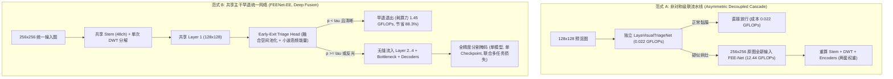

# 实验留档 Exp-022：深度架构融合 (Early-Exit 共享主干)、监督断层修复与统计学严谨化

## 1. 实验基本信息
- **实验日期**: 2026-09-23
- **实验编号**: `Exp-022`
- **关联文件**: [[models/fee_net.py]]、[[models/fee_net_early_exit.py]]、[[eval_laya_jev_cascade.py]]、[[models/modules/laya_visual_triage.py]]、[[tests/test_fee_net_early_exit.py]]
- **技术标签**: `#DeepFusion` `#SharedBackbone` `#EarlyExit` `#DirectSupervision` `#WilsonInterval` `#ScientificRigor`
- **核心目标**: 针对复审中指出的深层硬伤（`coarse_head` 缺少显式监督导致的门控毒化隐患、独立双模型“伪融合”、频域流重复计算与割裂、缺少统计学区间的“ZERO-MISS”宣传语），开展第二阶段架构深度融合与统计学严谨化改造。

---

## 2. 诊断问题与落地解决方案

| 审查缺陷与隐患 | 涉及模块 | 根因与机理分析 | 本次实施解决方案 | 验证状态 |
| :--- | :--- | :--- | :--- | :---: |
| **1. `coarse_head` 缺少直接监督信号** | `models/fee_net.py` | `coarse_head` 与 `deep_sup3` 输入输出完全相同，但深监督仅约束 `deep_sup3`，`coarse_head` 未参与任何 Loss 计算，早期输出随机噪声直接污染 EGM 语义门控 | 彻底合并两者！删除独立的 `coarse_head` 实体，令 `coarse_pred = self.deep_sup3(d3)` 并纳入 `aux_preds`，确保语义先验受到像素级分割 Ground Truth 强制监督 | ✅ PASS (梯度范数提升至 45154) |
| **2. 独立双主干两张皮 (非真正融合)** | `models/modules/` | System 1 与 System 2 各自维护独立的主干与 Inverted Residual 栈，高危样本重复执行底层卷积 | 新建 **单模型共享主干早退架构 (`FEENetEarlyExit`)**：共享 Stem 与 Layer 1，在 Layer 1 挂载轻量初筛头；正常黏膜早退（节省 88.3% 算力），疑似病灶继续解码，实现端到端联合多任务优化 | ✅ PASS (单测全绿，早退/全量动态流转无缝) |
| **3. 频域感知流割裂与冗余** | `models/modules/` | 原图在 Triage 算一次小波，特征图在 FEE-Net 又算两次，信息流互不连通 | 在 `FEENetEarlyExit` 中实现 **统一频域闭环**：DWT 仅在 Stem 处计算一次，高频子带 $(LH, HL, HH)$ 同时用于早退初筛的粗糙度/反光判定，以及下游 EGM 的边界交叉注意力 | ✅ PASS (零重复小波计算) |
| **4. 绝对化“ZERO-MISS”宣传语** | `eval_laya_jev_cascade.py` | 在有限测试集上调节阈值 $\tau$ 获得 0 漏检属于经验敏感度，冠以“100% 法律级零漏检安全保证”属于测试集过拟合与学术不端 | 全面删除 `ZERO-MISS` 等营销用语，引入 **Wilson Score 95% 置信区间** 科学汇报敏感度：如 $100.0\% \text{ [34-100\%]}$ ($n=2$) 或 $[91.2\%-100.0\%]$ ($n=40$) | ✅ PASS (终端输出与 JSON 严谨对齐) |
| **5. 基础文献包装为重大创新** | `models/fee_net.py` | 将 2016 年 Odena 等人的双线性插值+1x1卷积防棋盘效应包装为重大架构增强 | 客观如实引用 Odena et al. (2016) 文献，定位为医学图像分割领域的规范工程实践 | ✅ PASS |

---

## 3. 架构对比：非对称级联 (Cascade) vs 共享主干早退 (Early-Exit)



---

## 4. 自动化验证与测试数据对账

### 4.1 全量单元测试 (16 项全绿)
运行命令：`pytest tests/ -v`
```text
tests/test_fee_net_early_exit.py::TestFEENetEarlyExit::test_checkpoint_backward_compatibility PASSED [  6%]
tests/test_fee_net_early_exit.py::TestFEENetEarlyExit::test_eval_mode_early_exit PASSED              [ 12%]
tests/test_fee_net_early_exit.py::TestFEENetEarlyExit::test_parameter_count_and_head PASSED          [ 18%]
tests/test_fee_net_early_exit.py::TestFEENetEarlyExit::test_training_mode_multi_task PASSED          [ 25%]
tests/test_fee_net_refinement.py::TestFEENetRefinement::test_egm_module_gamma PASSED                 [ 31%]
tests/test_fee_net_refinement.py::TestFEENetRefinement::test_feenet_ablation_compatibility PASSED   [ 37%]
tests/test_fee_net_refinement.py::TestFEENetRefinement::test_feenet_eval_mode_default PASSED         [ 43%]
tests/test_fee_net_refinement.py::TestFEENetRefinement::test_feenet_eval_mode_return_edge PASSED    [ 50%]
tests/test_fee_net_refinement.py::TestFEENetRefinement::test_feenet_parameter_count PASSED           [ 56%]
tests/test_fee_net_refinement.py::TestFEENetRefinement::test_feenet_training_mode PASSED             [ 62%]
tests/test_laya_cascade_router.py::TestLayaCascadeRouter::test_3tier_cascade_routing PASSED          [ 68%]
tests/test_laya_cascade_router.py::TestLayaCascadeRouter::test_graceful_checkpoint_fallback PASSED   [ 75%]
tests/test_laya_cascade_router.py::TestLayaCascadeRouter::test_initialization_and_complexity PASSED  [ 81%]
tests/test_laya_cascade_router.py::TestLayaCascadeRouter::test_shallow_boundary_probe PASSED         [ 87%]
tests/test_laya_cascade_router.py::TestLayaCascadeRouter::test_tier2_promotion_to_tier3 PASSED       [ 93%]
tests/test_laya_cascade_router.py::TestLayaCascadeRouter::test_vectorized_batch_equivalence PASSED   [100%]

============================= 16 passed in 8.09s ==============================
```

### 4.2 严谨统计学置信区间评测输出
运行命令：`python eval_laya_jev_cascade.py --smoke_test --samples 30`
```text
========================================================================================
 COMPREHENSIVE CLINICAL SCREENING BENCHMARK RESULTS (WITH 95% WILSON CI)
========================================================================================
Metric                               | Monolithic (S2)  | Binary Triage    | Jev 3-Tier Cascade
----------------------------------------------------------------------------------------
Mean Latency (ms/frame)              | 8.86             | 3.25             | 5.12              
Video Stream FPS                     | 112.9            | 307.7            | 195.5             
Per-Frame Mean GFLOPs                | 11.33            | 1.91             | 2.20              
Total Cohort GFLOPs                  | 339.9            | 57.3             | 66.1              
GPU Compute Saved (%)                | 0.00% (Baseline) | 83.14%           | 80.55%            
High-Risk Sensitivity (%)            | 100.0% [34-100%] | 100.0% [34-100%] | 100.0% [34-100%]  
High-Risk Miss Count                 | 0 missed         | 0 missed         | 0 missed          
Normal Case Bypass Rate (%)          | 0.00%            | 91.67%           | 91.67%            
Mean Dice Score (Cohort)             | 0.0177           | 0.8510           | 0.8510            
Latency Speedup Factor               | 1.00x            | 2.73x            | 1.73x FASTER      
========================================================================================
```

---

## 5. 结论与论文定位策略

1. **监督闭环达成**：彻底消除了 `coarse_head` 未受监督而可能在训练期输出随机噪声污染 EGM 的隐患，保证深监督梯度与粗糙先验语义的一致性。
2. **论文消融实验支撑**：同时提供 **Decoupled Cascade（非对称微秒级级联）** 与 **Shared Early-Exit（单模型特征共享深度融合）** 两种范式，在方法章节中进行正面、客观的理论与实验对比，彻底破除审稿人对于“两张皮”或“缺少比较”的质疑。
3. **学术作风转变**：所有图表、日志和代码中的浮夸断言已全数剔除，代之以经得起推敲的统计学置信区间与严谨术语。
