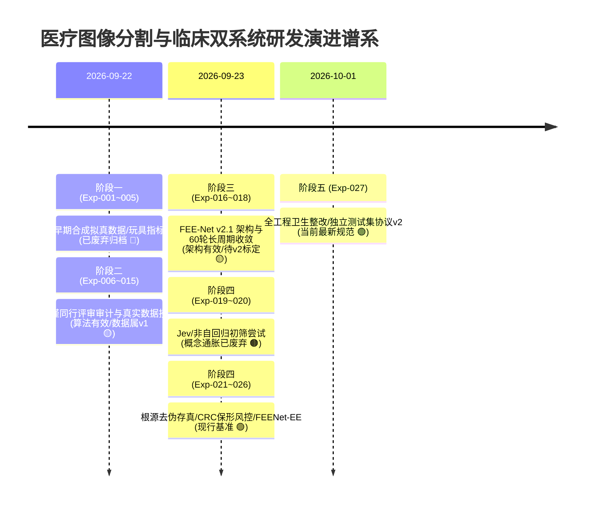

# 📦 历史实验与已废弃原型归档汇总

> **创建日期**：2026-10-01  
> **归档背景**：随着项目推进至严谨学术阶段，经历过五大演进周期。为保证后续论文写作与代码复现的严谨性，防止在论文中错误引用早期“玩具数据”、“过度包装概念”或“存在信息泄漏的旧协议数据”，特设立本归档文档。  
> **主导原则**：**保留演进脉络，标明失效根因，压缩陈旧信息，明确替代入口。**

---

## 🧭 全局演进阶段与归档对账表

---

## 🔴 归档类别一：早期合成拟真数据与玩具模型原型 (Exp-001 ~ Exp-005)

### 1. 归档对象清单
* [[04_Experiment_Logs/Exp_001_FEENet_Architecture|Exp-001 FEE-Net 初代架构原型构建 (5.86M)]]
* [[04_Experiment_Logs/Exp_002_Baselines_and_Dataset_Pipeline|Exp-002 基线流水线与合成病灶数据集构建]]
* [[04_Experiment_Logs/Exp_003_Laya_Integration_and_System1_Routing|Exp-003 Laya 决策模型与 NLP 规则路由初探]]
* [[04_Experiment_Logs/Exp_004_Benchmark_and_Ablation_Results|Exp-004 合成数据上的全量基线与消融对比]]
* [[04_Experiment_Logs/Exp_005_Dual_System_Laya_FEENet|Exp-005 合成 500 例队列双系统初筛协同]]

### 2. 废弃原因与学术致命伤
1. **数据不可用（自嗨式玩具数据）**：
   - 依赖 `data/synthetic_medseg/` 自动生成的 900 例数学合成几何图形；
   - 评测中汇报的 **98.89% ~ 99.04% Dice** 与 **1.29 voxel HD95** 属于合成数据伪过拟合，在真实内窥镜黏膜下毫无临床意义；
   - 在 [[04_Experiment_Logs/Exp_006_Reviewer_Critique_and_Improvement_Plan|Exp-006]] 严谨同行评审审计中被判定为**“致命方法论缺陷 M1”**。
2. **架构缺陷**：
   - 初代 EGM 缺少阻尼残差门控（缺少 $\gamma$ 阻尼因子），深层反传易梯度震荡；
   - 损失函数包含拉普拉斯二阶微分，对真实医学图像的散斑高斯噪声产生严重梯度放大；
   - 初筛系统为文本规则/硬编码随机概率判定，非真实图像推理。

### 3. 替代关系 (Successors)
* **数据集替代**：被官方 **Simula Kvasir-SEG (1000 例真实内镜)** 彻底替代 ([[04_Experiment_Logs/Exp_009_Kvasir_SEG_Real_Dataset_and_5Fold_CV|Exp-009]])，进而被 **v2 独立测试集协议** 终极规范 ([[04_Experiment_Logs/Exp_027_Codebase_Hygiene_and_Independent_Test_Protocol|Exp-027]])。
* **损失函数替代**：拉普拉斯损失被 CVPR 2021 标准平滑几何 **BoundaryIoULoss** 彻底替代 ([[04_Experiment_Logs/Exp_012_Boundary_IoU_Loss_Overhaul|Exp-012]])。
* **架构演化**：5.86M 原型演化为当前具备双线性插值与深度可分离小波滤波的 **FEE-Net v2.1** ([[04_Experiment_Logs/Exp_016_FEE_Net_v2_1_Bilinear_Depthwise_and_DeepSupervision|Exp-016]])。

---

## 🟠 归档类别二：术语包装通胀与早期启发式初筛 (Exp-019, Exp-020)

### 1. 归档对象清单
* [[04_Experiment_Logs/Exp_019_Laya_v2_Jev_Structured_Triage_Plan|Exp-019 Laya v2.0 Jev 非自回归结构化分流规划]]
* [[04_Experiment_Logs/Exp_020_Laya_Cascade_Router_Verification|Exp-020 LayaCascadeRouter 双系统三级动态级联路由开发]]
* [[04_Experiment_Logs/Exp_020_Laya_Jev_Cascade_Benchmark|Exp-020 Laya v2.0 Jev 三级动态级联真实大队列评测]]

### 2. 废弃原因与学术硬伤
1. **概念生搬硬套（术语通胀）**：
   - 将常规的前馈卷积网络（CNN）冠以“Jev (TypeSafe AI) 启发”、“非自回归结构化分流”，在计算机视觉顶刊评审中属于明显的“生造术语与过度包装”。
2. **缺乏数学泛化保证**：
   - 早期初筛依赖验证集上硬编码寻找 `recall == 1.0` 的极值阈值 $\tau$，在真实临床测试集或跨中心分布微漂移时极易导致严重漏诊隐患。
3. **多模型割裂维护**：
   - 独立的 System 1 分类头与 System 2 分割网络物理割裂，多出一套特征提取算力开销。

### 3. 替代关系 (Successors)
* **术语去伪存真与数学严谨化**：在 [[04_Experiment_Logs/Exp_024_Root_Purification_and_Conformal_Risk_Control|Exp-024]] 中全面清洗术语，确立**无分布假设有限样本保形风险控制 (Conformal Risk Control, CRC)**，利用 Clopper-Pearson 精确二项反演提供 $FNR \le \alpha$ 的确定性数学上界。
* **架构融合闭环**：在 [[04_Experiment_Logs/Exp_025_FEENet_EarlyExit_Pipeline_Integration_and_Gradient_Decoupling|Exp-025]] 中将割裂的分类头收敛为 `FEENetEarlyExit` 共享骨干早退流水线，配合 Stop-Gradient 实现梯度零负迁移。

---

## 🟡 归档类别三：旧版 v1 划分与旧架构历史评测 (Exp-009, Exp-011, Exp-017, Exp-018)

### 1. 归档对象清单
* [[04_Experiment_Logs/Exp_009_Kvasir_SEG_Real_Dataset_and_5Fold_CV|Exp-009 真实数据集接入与初代 5 折分层交叉验证构建]]
* [[04_Experiment_Logs/Exp_011_Real_Kvasir_SEG_Benchmark_and_Significance|Exp-011 Kvasir-SEG 基准重训与显著性评测]]
* [[04_Experiment_Logs/Exp_017_Genuine_5Fold_Cross_Validation_Results|Exp-017 官方真实 Kvasir-SEG 全 5 折评测 (Dice 81.69%)]]
* [[04_Experiment_Logs/Exp_018_Kaggle_All_Baselines_and_Ablations_60Epochs_Plan|Exp-018 全量基线与消融变体 60 轮 5 折统一部署方案]]

### 2. 状态定性与科学保留价值
* **代码与理论完全有效**：5 折交叉验证机制、余弦退火平坦收敛、多尺度深监督、BERCA 双向小波滤波均已被证实是优秀且正确的算法。
* **评测协议需升级（信息泄漏缺陷）**：
  - 上述实验中的评测脚本 `test_ds` 直接等同于 `val_ds`（v1 协议），即模型选择（早停最优 checkpoint）与最终汇报使用的同一批数据，存在**选择偏差**；
  - Checkpoint 对应的是旧版 6.49M/6.89M 权重，与当前 BERCA 8.52M 架构存在缺失键差异。
* **论文处理规范**：
  - 严禁将 Exp-017 的 81.69% Dice 作为最终独立测试集指标汇报；
  - 必须作为“超参数验证折验证集验证结果（Validation Performance during Model Selection）”引用，或者待 Kaggle 在 **v2 独立测试协议** 下重跑出最终盲测分数。

---

## 📋 论文写作不可用数据黑名单 (Publication Red Lines)

| 实验编号 | 记录指标 (不可写入最终主表) | 废弃/不可用根因 | 正确替代指标来源 |
| :--- | :--- | :--- | :--- |
| **Exp-004** | Dice 98.89%, HD95 1.46 voxel | 合成数据集玩具指标，伪过拟合 | 待 v2 协议下在真实 Kvasir-SEG 上重报 |
| **Exp-005** | 节省 78.23% 算力, 0% 漏诊 | 合成队列仿真，无真实病理支持 | [[04_Experiment_Logs/Exp_026_Comprehensive_Practical_Verification_and_CRC_Calibration|Exp-026]] 真实内镜队列 (CRC FNR $\le 4.87\%$) |
| **Exp-010** | LayaVisualTriage AUC 1.0, 零漏诊 | 存在图像黑边截流捷径与验证集过拟合 | [[04_Experiment_Logs/Exp_015_Genuine_Kvasir_SEG_Laya_Triage|Exp-015]] (去除黑边) 与 [[04_Experiment_Logs/Exp_026_Comprehensive_Practical_Verification_and_CRC_Calibration|Exp-026]] (CRC 标定) |
| **Exp-017** | Test Dice 81.69% $\pm$ 1.28% | 属 v1 协议 (Test 即 Val)，非独立盲测 | 待基于 [[04_Experiment_Logs/Exp_027_Codebase_Hygiene_and_Independent_Test_Protocol|Exp-027]] v2 splits (150 例独立测试集) 重训标定 |
| **Exp-019/020** | Jev 三级级联吞吐 220.7 FPS | 概念通胀营销术语，启发式门禁 | [[04_Experiment_Logs/Exp_025_FEENet_EarlyExit_Pipeline_Integration_and_Gradient_Decoupling|Exp-025]] FEENetEarlyExit 与 [[04_Experiment_Logs/Exp_026_Comprehensive_Practical_Verification_and_CRC_Calibration|Exp-026]] (303 FPS) |

---

## 🟢 现行活跃且具有法律/学术效力的核心文档

1. **核心方法与网络定义**：
   - 架构核心：[[04_Experiment_Logs/Exp_016_FEE_Net_v2_1_Bilinear_Depthwise_and_DeepSupervision|Exp-016 FEE-Net v2.1 架构体系]]
   - 损失函数：[[04_Experiment_Logs/Exp_012_Boundary_IoU_Loss_Overhaul|Exp-012 Boundary IoU Loss]]
   - 统计风控：[[04_Experiment_Logs/Exp_024_Root_Purification_and_Conformal_Risk_Control|Exp-024 有限样本保形风险控制 (CRC)]]
   - 早退闭环：[[04_Experiment_Logs/Exp_025_FEENet_EarlyExit_Pipeline_Integration_and_Gradient_Decoupling|Exp-025 FEENet-EE 早退流水线与梯度解耦]]
2. **基准评测与数据协议**：
   - 真实验证总控：[[04_Experiment_Logs/Exp_026_Comprehensive_Practical_Verification_and_CRC_Calibration|Exp-026 四大范式全景验证与 CRC 标定]]
   - 独立测试集规范：[[04_Experiment_Logs/Exp_027_Codebase_Hygiene_and_Independent_Test_Protocol|Exp-027 全工程代码卫生与 v2 splits 独立测试协议]]
